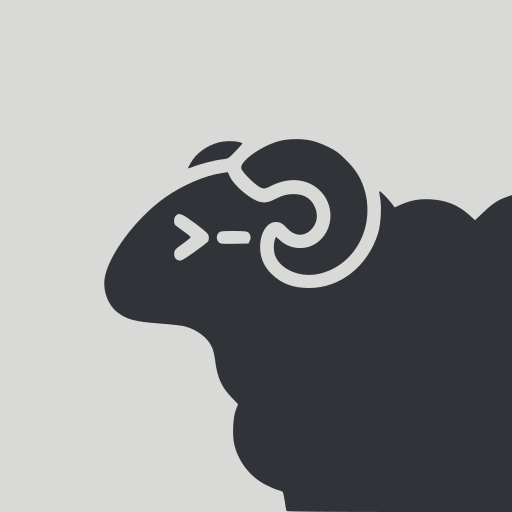
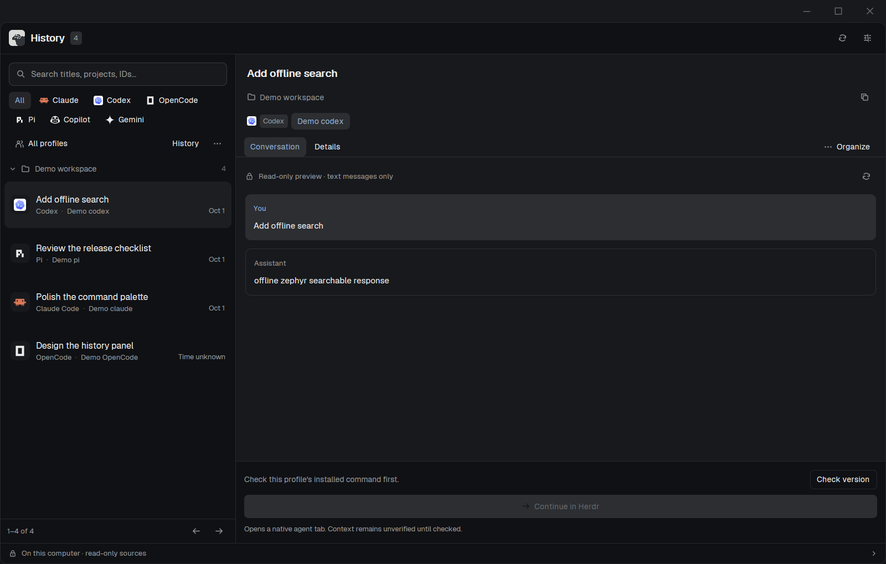
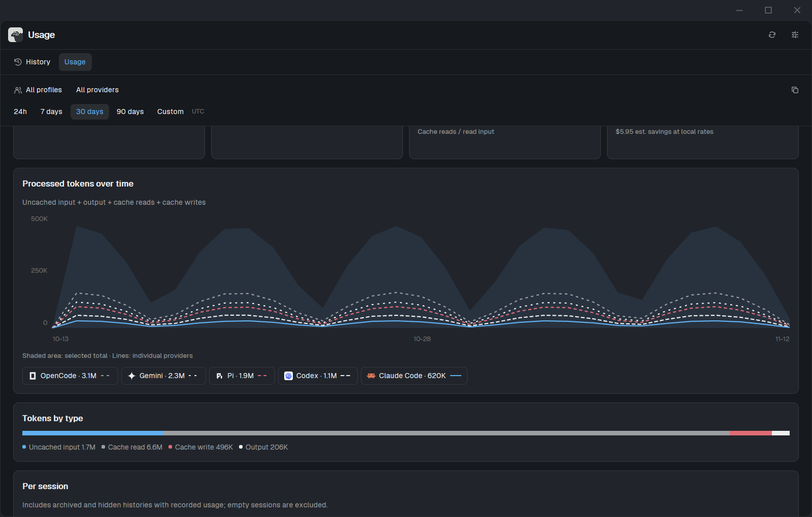

<p align="center">
  <a href="https://herdr.dev"></a>
</p>
<h1 align="center">Herdr Session Hub</h1>
<p align="center">Your local sessions and recorded usage, together in Herdr.</p>
<p align="center">
  <a href="LICENSE"></a>
  <a href="https://herdr.dev"></a>
  <a href="https://github.com/Skynettheone/herdr-session-hub/actions/workflows/ci.yml"></a>
  <a href="https://github.com/Skynettheone/herdr-session-hub/actions/workflows/codeql.yml"></a>
  
  
</p>
<p align="center"><a href="#install">Install</a> · <a href="#history-and-usage">Features</a> · <a href="#compatibility">Compatibility</a> · <a href="docs/USER_GUIDE.md">User guide</a></p>



A native Herdr Desktop mod for finding, searching, organizing and continuing local
coding-agent sessions. **History** and **Usage** share one collapsible tab beside
**Files** and **Changes**, with Herdr's own colors, agent icons and theme behavior.
The captures use synthetic histories; no personal conversations are shown.

## Install

Ask the agent running in Herdr:

```text
Read ~/.config/herdr-app/AGENTS.md, then add this mod:
https://github.com/Skynettheone/herdr-session-hub
Follow its RECIPE.md and preserve my existing layouts, shortcuts and provider histories.
```

The agent must review the helper and installers, explain what they read/run, and
use a verified bundle for your platform. **Copying only `mods/session-hub` is not
sufficient**: the Python runtime and `runtime.json` must also be configured.
[Agent installation guide](docs/INSTALL_WITH_AGENT.md) · [Recipe](RECIPE.md)

**[Download Windows 0.1.0](https://github.com/Skynettheone/herdr-session-hub/releases/tag/v0.1.0)**,
the first stable release for **Windows 11 x64**. The release includes the verified
offline ZIP, checksums and installation notes. Linux/macOS remain
**0.1.0-experimental.1**, with native continuation disabled and no assets attached
to this stable release. [Release notes](docs/RELEASE_NOTES.md)

### From a verified bundle

Requires **Herdr 0.1.15** and **CPython 3.14**. Compare the ZIP's SHA-256 with a
trusted receipt, extract it, review the files, then close Herdr before installing.

Windows PowerShell:

```powershell
pwsh -NoProfile -File scripts/install.ps1 -AppHome "$HOME/.config/herdr-app" -InstallProduction
herdr-app do mod.open --name session-hub
```

Linux x64 / Apple Silicon macOS experimental test bundles:

```sh
python3.14 -I -B scripts/install.py install --app-home ../.dev/session-hub-posix-test
```

Linux needs `secret-tool` and an unlocked Secret Service; macOS needs an unlocked
Keychain. The installer uses offline, hash-locked dependencies, keeps an upgrade
backup and leaves your layout/keys untouched. Click **Dock** in History to add its
tab through a new personal layout copy. Click the tab again to collapse it.

For a disposable test install, omit the production switch and choose a child of
the bundle parent's `.dev` directory. [Setup, upgrade, rollback and uninstall](docs/USER_GUIDE.md)

## History and Usage

- **Find old sessions.** Explicit provider profiles, custom roots, project groups,
  metadata search and opt-in local full-text search.
- **Continue in context.** Supported Windows providers open their native session
  in a new Herdr tab, using the selected profile and recorded project directory.
- **Keep originals intact.** Previews are read-only. Names, archive flags and
  removal/restore live in Hub metadata.
- **Understand recorded usage.** Native token/cache graphs, UTC date ranges,
  provider/profile filters, model/day/project breakdowns and session averages.
- **Price only what is known.** Exact local model rates or recorded provider
  costs; unknown prices and incomplete coverage stay visible.
- **Fit your workspace.** Responsive narrow/wide layouts, collapse controls,
  keyboard-friendly fields and semantic built-in/community theme colors.



Usage is local recorded accounting. API-equivalent estimates are not subscription
bills; recorded limit snapshots are not live account quotas.
[Using History and Usage](docs/USER_GUIDE.md)

## Compatibility

| Platform | Local helper / encrypted state | Native Herdr continuation |
|---|---|---|
| Windows 11 x64 (stable) | Verified | Verified for the versions below |
| Linux x64 (experimental) | Tested on Ubuntu 24.04, including Secret Service | Disabled pending native GUI/context acceptance |
| Apple Silicon macOS (experimental) | Tested on macOS 15, including Keychain | Disabled pending native GUI/context acceptance |
| Intel macOS / other architectures | No accepted bundle | Unavailable |

Verified Windows CLIs: **Claude Code 2.1.322**, **Codex 0.164.0**, **Pi 1.1.0**,
**OpenCode 1.3.17**, **Gemini 0.49.0**, with Herdr GUI **0.1.15** / core **0.1.20**.
Unknown versions, active ownership and ambiguous identities disable continuation.
Gemini duplicate snapshots fail closed. Copilot history is experimental;
continuation is unavailable. Other Herdr agents appear in the capability catalog
without guessed history readers or launch commands.

Stable support is Windows x64 only. Promoting macOS/Linux requires native GUI,
continuation and updater acceptance on each target; their passing helper/key-store
tests do not establish desktop support. UNC, WSL history roots and network mounts
are unsupported.

## Privacy and safety

Hub has no runtime telemetry or HTTP client. It reads only configured roots;
provider credentials are never read, copied or exported. State is encrypted with
Windows DPAPI or a Hub-only Keychain/Secret Service key. Original deletion,
native transcript migration and remote sync are unavailable. Encrypted metadata
file exchange is supported, with dry-run import and conflicts preserved.

Herdr mods are trusted code. Native provider CLIs can use their own hooks and
network after you request continuation. Distinct company-account identities have
not been verified. [Security policy](SECURITY.md) · [Dependency and artwork notices](THIRD_PARTY_NOTICES.md)

## Source and verification

Install bundles contain only runtime, matching wheels, installers, licenses and
user documentation. Tests, build tools, fixtures and audit history stay in the
[source repository](https://github.com/Skynettheone/herdr-session-hub).

[Contributing](https://github.com/Skynettheone/herdr-session-hub/blob/main/CONTRIBUTING.md) ·
[Test evidence](https://github.com/Skynettheone/herdr-session-hub/blob/main/docs/TEST_RESULTS.md) ·
[Release receipts](https://github.com/Skynettheone/herdr-session-hub/blob/main/docs/RELEASE_REPORT.md) ·
[Port acceptance](https://github.com/Skynettheone/herdr-session-hub/blob/main/docs/PORT_ACCEPTANCE.md)

MIT licensed. Herdr artwork and the scoped native header adapter retain their
Apache-2.0 notices. This community mod is not endorsed by Herdr.
