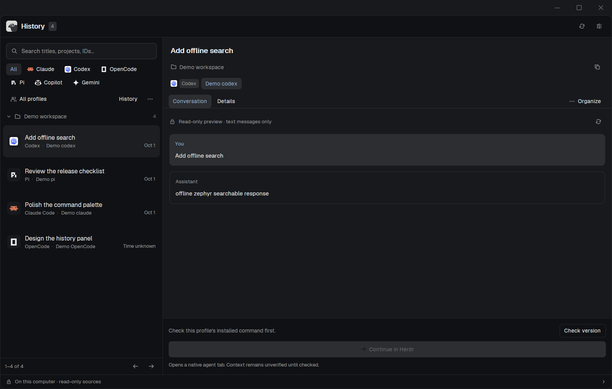

# Herdr Session Hub

A native History and Usage panel beside Herdr's Files and Changes. Find local
agent sessions, read safe previews, organize without editing originals, and
continue supported native sessions in their recorded project. Switch to Usage
for themed token/cache/cost graphs and numeric breakdowns.

## Install with an agent

Read the installed `~/.config/herdr-app/AGENTS.md`, this recipe, the platform
installer and every runtime file first. Explain that the mod runs a local Python
helper, reads explicitly configured histories and writes Hub-owned encrypted
state. A user-requested native provider can run its own hooks/network. Hub has no
HTTP client. Installation is not part of a review/preparation-only request.

Use a matching checksum-verified bundle with CPython 3.14 and Herdr 0.1.15.
Version 0.1.0 stable supports Windows x64 only. POSIX bundles are explicitly
0.1.0-experimental.1 and keep native continuation disabled.
Get the Windows bundle and checksums from the
[v0.1.0 release](https://github.com/Skynettheone/herdr-session-hub/releases/tag/v0.1.0).
Experimental POSIX bundles are source-build only. If a source build is needed, use
[CONTRIBUTING.md](https://github.com/Skynettheone/herdr-session-hub/blob/main/CONTRIBUTING.md); do not
invent an asset URL or copy only the mod directory. Follow
[INSTALL_WITH_AGENT.md](docs/INSTALL_WITH_AGENT.md).

Use `scripts/install.ps1` on Windows or `scripts/install.py install` on Linux x64 /
Apple Silicon macOS. Both configure the helper/runtime and check the mod before
activation. Existing unrelated `mods/session-hub` files are a name conflict:
resolve it with the user, never overwrite them. Genuine Hub upgrades retain a
backup and old runtime. Do not change existing shortcuts or shipped mods.

## What you see

- One History tab beside Files/Changes after an explicit Dock action. Clicking
  the tab again collapses the same panel. Installation itself uses `place=none`.
- History has search, provider/profile filters, refresh status and collapsible
  project groups. Compact rows show title, agent/profile and conversation time.
- Wide layouts use a list/detail split; below 760 logical pixels, selection opens
  detail in place with Back. Conversation, Details and Organize are adjacent tabs.
- Settings has profiles, installed-agent capability status, opt-in text search
  and encrypted metadata portability. Guided forms retain Save/Cancel controls.
- Usage shares the panel: UTC ranges, profile/provider filters, Tokens/Est. cost/
  Limits, equal-height summary cards, native path graphs and numeric breakdowns.
- Colors come from Herdr's semantic theme on every render. Built-in agent artwork
  comes from `knownAgents()` with its native tint/full-color behavior. The official
  sheep mark and licensed scoped header adapter retain Apache-2.0 notices.

## How it behaves

Search is debounced; refresh is incremental, cancellable and available after
onboarding. Loading/error/empty/partial states stay distinct. Previews are bounded
plain text with tool payloads omitted. Alias/archive/remove/restore change Hub
metadata only. Content indexing is Off until the user opts in for a profile.

Native continuation requires a selected profile, exact researched executable
version/fingerprint, trusted recorded project, current source and idle ownership.
It opens a Herdr tab with an argv vector and original cwd. A launch alone is not
reported as verified context continuation. Unknown/active/ambiguous sources fail
closed. Never acknowledge trust/authentication/privacy notices for the user.

Usage caches numeric accounting inside encrypted Hub state, independently of text
search. It deduplicates billed events before filters. Unknown prices and partial
coverage remain visible. API-equivalent estimates are not subscription charges;
local recorded limits are timestamped snapshots, not live cloud quotas.

## Built from

`mods/session-hub/main.js` exports a native GPUI View. `model.js`, `ui.js` and
`usage.js` provide state/rendering; `tabs.js` is an owned Apache-2.0 adaptation of
the pinned native header. Header props use `role: "tabs"`; the History view's
`panel` prop identifies its collapsible layout block. The header never scans.

The mod uses `exec` for argument-vector helper calls, `run("tab.new", …)` for
verified continuation, native inputs/path painting, `knownAgents`, `theme`,
`readTextFile`, compare-and-create `writeTextFile`, and supported layout commands.
Dock creates a new personal layout copy; it does not overwrite the original.
There is no Node, React, DOM, Electron or webview in the mod runtime.

`helper/hub.py` and the fixed `helper/adapters` package implement local discovery,
indexing, usage, metadata and launch policy. CPython 3.14 supplies bounded zstd;
SQLite FTS5 stays in memory and serializes into encrypted state. Windows uses
DPAPI; POSIX uses a Hub-only Keychain/Secret Service key with PyCA AES-GCM.
Offline wheels and platform installers accompany the mod in install bundles.

## Watch out

- Windows continuation is verified for Claude 2.1.322, Codex 0.164.0, Pi 1.1.0,
  OpenCode 1.3.17 and Gemini 0.49.0 with Herdr 0.1.15/core 0.1.20.
- Linux/macOS helper/key-store tests pass, but native Herdr GUI/context acceptance
  is pending. Continuation stays disabled there. Other architectures have no
  accepted bundle. Do not remove these guards or label an experimental port stable.
- Shared/duplicate identities, active writers, unknown cwd, giant/partial sources
  and version drift need their visible disabled/partial states. Gemini replay is
  bounded; duplicate snapshots are ambiguous. See the user guide for budgets.
- UNC/WSL history roots, network mounts, original deletion, native transcript
  migration and remote sync are unavailable. Encrypted exchange is metadata-only.
- OS key-store denial/missing keys must preserve encrypted evidence; no plaintext
  fallback. Default uninstall retains state. Never delete provider originals.

## Done when

The bundle's complete allowlist/manifest and wheel hashes verify; the matching
installer configures a private runtime without changing existing layouts/keys;
`herdr-app check` passes using an isolated app home. In an actual target GUI,
History/Usage switch, collapse, filters, forms, refresh and error/disabled states
must work. Any enabled native continuation must retain session ID, profile, cwd
and prior context. Source hashes stay unchanged after browse/search/organization.
Native SDK checking alone does not establish all of those interactions.
